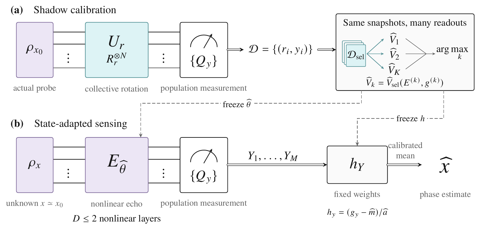
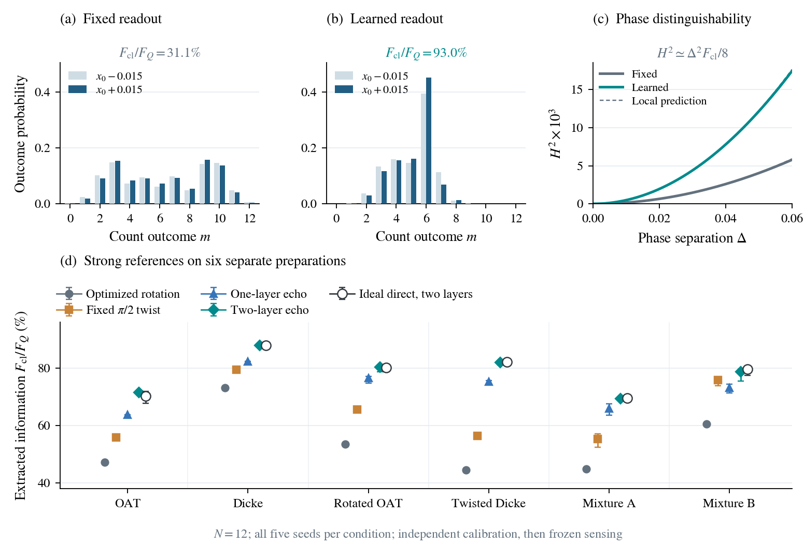
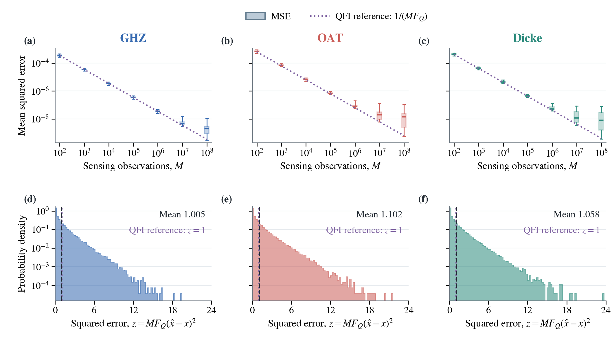

# Shadow-Calibrated Readouts for Quantum Metrology

**Qimin Zhou · Tongji University**  
Theory and numerical simulation · Public research overview

A quantum probe can be sensitive to a phase while a convenient measurement misses much of that information. This project studies how reusable classical-shadow data can guide the design of a nonlinear echo, turning the probe's phase sensitivity into a more informative population measurement.

**[Read the research report (PDF)](reports/Research_Report.pdf)** · [Results and validation details](docs/RESULTS.md)

## Research question

**How can we find a useful echo for the state actually prepared, without experimentally testing every candidate readout?**

The echo family studied here has five continuous controls per layer, with up to two layers. Direct-response optimization measures the response at the settings it queries. Classical shadows offer another route: acquire randomized measurement records during calibration, then reuse those records to evaluate many candidate controls offline.

The echo changes which information reaches the detector. The shadow record supplies the information used to choose the echo.

## Method

*One selection record is reused to compare many fixed echo–weight candidates. Separate independent records support control discovery, score fitting and estimator calibration. Fresh sensing begins after the echo and weights are frozen.*

For a candidate echo, both its outcome probabilities and their local phase derivatives are expectations of known observables on the reference probe. A variational score objective combines these into a single observable whose expectation equals the candidate's witness value; maximizing over all outcome weights using exact probabilities and derivatives recovers classical Fisher information (CFI).

The **current direct-shadow implementation** computes dual-frame weights for these known observables and averages them over raw calibration histograms. It does not construct an estimated density matrix or a complete estimated state-coefficient vector. Bounded scores stabilize the finite-sample search. Four independent records are used for discovery, score refitting, candidate selection and affine calibration. During sensing, the learned echo is followed by ordinary population counting and a fixed weighted mean.

## Selected results

All results below are numerical. The figures and larger comparisons retain their **earlier state-model implementation** provenance. The current direct implementation has a separate paired validation, summarized below and in the [evidence notes](docs/RESULTS.md).

### More information reaches the detector

*Top: for one noisy Dicke probe, the learned readout raises CFI/QFI from 31.1% to 93.0%, with the same probe and detector. Bottom: a separate comparison across six preparations at N = 12, with five seeds each. QFI denotes quantum Fisher information, the local information available in the probe.*

The six-preparation study gives the following mean extraction efficiencies:

| Readout or calibration reference | Mean CFI/QFI |
| :--- | ---: |
| Optimized collective rotation | 53.94% |
| Fixed π/2 twist with optimized surrounding rotations | 64.77% |
| Shadow-calibrated one-layer echo | 72.87% |
| Shadow-calibrated echo, at most two layers | **78.31%** |
| Ideal direct-response reference, at most two layers | 78.31% |

The direct-response reference receives exact probabilities. Its agreement with the shadow-guided search supports the attained readout quality; it is not a finite-shot resource comparison.

**Reusing the same data:** expanding the search from 32 to 128 starts per depth raises mean two-layer efficiency from **76.93% to 78.31%**, while retaining exactly the same four calibration records for every instance. Of the 30 instances, 21 improve, six decrease and three are unchanged to numerical tolerance.

### Independent sensing tests the estimator

*At N = 8 and preparation-noise strength ε = 0.15, frozen estimators are tested on fresh outcomes. The upper panels show mean-squared error (MSE) versus sensing repetitions; the lower panels show individual squared-error distributions at M = 10⁴. The normalized mean errors are 1.005, 1.102 and 1.058 for GHZ, OAT and Dicke, respectively. The QFI line is an ideal mean-error reference, not a bound on each individual error.*

The tests connect information extraction to actual phase estimates. They also show how finite calibration can leave an error floor when sensing repetitions become large.

### Direct queries preserve average performance in paired tests

In a separate 18-instance comparison using the same calibration records, the earlier state-model and current direct implementations achieve mean CFI/QFI of **96.9031% and 96.9680%**. The mean ratio of phase-window MSEs (direct/earlier) is **1.007425**. These are descriptive results for GHZ, OAT and Dicke probes at N = 4 and 8; they support similar average performance on the tested conditions. The larger figures above were not regenerated with the direct implementation.

## Personal contribution

The initial research direction was developed with faculty guidance. I led the adaptation and verification of the variational score formulation, implemented the readout-search and calibration algorithms, and carried out the numerical simulations. I also designed the comparisons and independent sensing tests, including checks of calibration bias after fixing the controls and estimator weights.

## Scope and materials

The study concerns local single-parameter sensing with a known generator, collective controls and population detection. The current implementation uses a complete permutation-invariant measurement frame. Avoiding explicit reconstruction does not, by itself, establish fewer calibration measurements or an advantage exclusive to shadows. A total-cost comparison with finite-shot adaptive response optimization remains open.

This repository contains the research report, selected figures and explanatory documentation. Source code, raw calibration records and development history are maintained separately and are not part of this public release. This is an ongoing research project, not a peer-reviewed publication.

## Selected background

- H.-Y. Huang, R. Kueng and J. Preskill, [Predicting many properties of a quantum system from very few measurements](https://doi.org/10.1038/s41567-020-0932-7), *Nature Physics* **16**, 1050–1057 (2020).
- S. P. Nolan, S. S. Szigeti and S. A. Haine, [Optimal and robust quantum metrology using interaction-based readouts](https://doi.org/10.1103/PhysRevLett.119.193601), *Physical Review Letters* **119**, 193601 (2017).
- L. Innocenti et al., [Shadow tomography on general measurement frames](https://doi.org/10.1103/PRXQuantum.4.040328), *PRX Quantum* **4**, 040328 (2023).

The [research report](reports/Research_Report.pdf) contains the derivations and full reference list.
